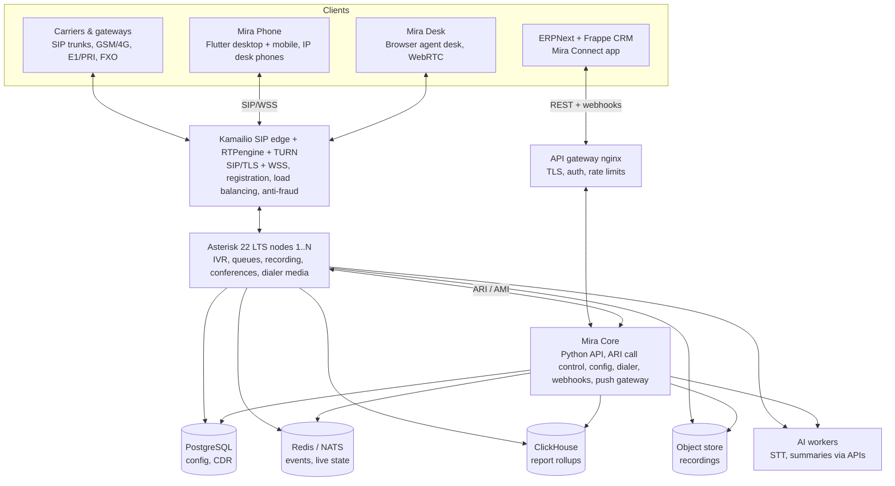

# Mira Voice — Product & Technical Study

Nov 25, 2026 · Khaled Samir (NSD)

## Executive summary

**Recommendation: build Mira Voice directly on Asterisk 22 LTS, with your own control plane, and do not use Issabel as the product base.** Keep Issabel only as a short-term delivery tool for clients who need a phone system before Mira is ready.

Issabel is a good PBX distribution, but it is a PHP web layer (an Elastix fork) around an older Asterisk build, with a small community and its own release cadence. A product you will sell for years needs to own its data model, its multi-tenancy, its APIs and its upgrade path. Asterisk 22 is a long-term-support release with bug fixes until October 2028 and security fixes until October 2029, so it is a safe engine for the next four years.

**What Mira Voice is, in one line:** a multi-tenant cloud (or on-premise) contact center with a visual IVR builder, queues (ACD), an outbound dialer, recording, live wallboards and reports, desktop and mobile softphones, any-gateway connectivity, and a native ERPNext / Frappe CRM app.

**The stack in one line:** Kamailio (SIP edge, WebRTC, load balancing) + RTPengine (media relay) + Asterisk 22 (IVR, queues, recording, conferencing) + Mira Core (Python API, PostgreSQL, Redis, event bus) + Mira Desk (Vue 3 web agent desktop) + Mira Phone (one Flutter app for Windows, macOS, Android, iOS) + Mira Connect (Frappe app for ERPNext).

**The three things that decide success:**

1. **Licensing and carriers, not code.** In Egypt, offering call-center or VoIP services to third parties needs an NTRA licence, and GSM-gateway termination is legally sensitive. Mira should be sold as *software the customer owns and runs on their own lines* until you have a licensed carrier partner. Saudi Arabia needs a CST-licensed partner and in-Kingdom hosting.
2. **The agent and supervisor experience.** Competitors all have queues and IVR; buyers choose on how fast an agent can handle a call inside ERPNext and how clearly a supervisor sees the floor.
3. **Arabic-first AI.** Arabic transcription, call summaries and QA scoring are now achievable with open models and are the strongest differentiator against imported platforms.

**Realistic timeline for a two-person team with AI-assisted development:** a sellable MVP (inbound IVR + queues + recording + web softphone + ERPNext app + core reports) in about 6 months; v1.0 with mobile apps, dialer, wallboards, WhatsApp, SMS, web chat, an Arabic AI voice agent and multi-tenant SaaS in about 16 months. The main regional benchmark is Ziwo; see Mira vs Ziwo for how Mira beats it. Details in the delivery plan below.

## Market study

The market splits into four groups. Mira's opening is the gap between expensive global CCaaS platforms and PBX-grade open-source tools: an Arabic-first contact center that lives inside ERPNext and can run on the customer's own servers.

### Who sells what

| Group | Examples | Strengths | Weaknesses Mira can attack |
| --- | --- | --- | --- |
| Global enterprise CCaaS | [NICE CXone](https://www.ringcentral.com/call-center-solutions.html), Genesys Cloud CX, Five9, Talkdesk, Amazon Connect | Omnichannel routing, workforce management, QA, deep analytics, AI. ISG's 2026 buyers guide ranks NICE, Verint and Genesys top three ([ISG](https://research.isg-one.com/hubfs/crm-properties-file-values/ISG_Buyers_Guide_Contact_Centers_2026_Executive_Summary.pdf?hsLang=en)) | Per-agent USD pricing, no on-premise, weak Egyptian/Gulf Arabic, no ERPNext integration, data hosted abroad |
| PBX vendors with call-center add-ons | [3CX](https://3cx.com/call-center/), Yeastar P-Series, Wildix, Sangoma FreePBX commercial modules | Cheap, mature PBX, softphones, wallboards. 3CX prices per system, not per seat ([3CX](https://www.3cx.com/ordering/pricing/)) | Shallow ACD and reporting, closed source, generic CRM connectors, no Arabic AI |
| Open-source contact center | [VICIdial](https://dev.to/gamlin/vicidial-the-complete-guide-to-open-source-call-center-software-j2n) (14,000+ installs), GoAutoDial, ICTContact, Wazo, FusionPBX, Issabel | Free, predictive dialing (VICIdial), full control | Dated UIs, hard to run, little multi-tenancy, no mobile apps worth using; reviewers note FusionPBX, Issabel and Wazo offer only basic inbound queues ([dev.to](https://dev.to/gamlin/open-source-call-center-software-in-2026-what-actually-works-1bd5)) |
| Regional Arabic platforms | [Maqsam](https://www.capterra.in/software/1068941/Maqsam) (from about USD 45/user/month), Unifonic, local Egyptian integrators | Arabic UI and speech analytics, local numbers, MENA presence | Cloud-only SaaS, generic CRM integrations, no ERPNext, no on-premise or customer-owned option. Ziwo is the strongest of these; see Mira vs Ziwo |

### Features every serious buyer now expects

- Visual IVR / call-flow designer with time conditions, holidays, and data dips (look up the caller in the CRM before routing).
- Skills-based ACD with service-level targets, callbacks instead of waiting, and overflow rules.
- Desktop + mobile + browser softphones, with presence and push wake-up on mobile.
- Live wallboards and historical reports (service level, abandon rate, AHT, occupancy).
- 100% call recording with search, and screen pop + click-to-call inside the CRM.
- AI: transcription, summaries, sentiment, QA scoring and, increasingly, voice bots that handle routine calls ([Cresta 2026 ranking](https://cresta.com/guides/best-contact-center-software)).

### Mira's positioning

- **For** ERPNext and Frappe CRM users in Egypt and Saudi Arabia, 5 to 300 agents.
- **Against** imported CCaaS: own your data, Arabic-first AI, priced in local currency, on your servers or ours.
- **Against** 3CX / Issabel installs: a real contact center (skills routing, dialer, QA, AI) that is native to ERPNext, not a PBX with a plug-in.
- **Moat:** the Frappe integration plus the Egyptian/Gulf Arabic speech layer. Both are hard for global vendors to copy for a small market.

## Mira vs Ziwo

**Ziwo is the competitor to beat in Egypt and the Gulf, and Mira can beat it on three fronts it cannot easily follow: on-premise deployment, native ERPNext (and Odoo) depth, and price.** To win the cloud deals as well, Mira must first close five gaps Ziwo already covers: WhatsApp, an Arabic AI voice agent, phone numbers, CRM connector breadth, and ISO 27001 / CST compliance.

### Who Ziwo is

- Dubai-based cloud contact center founded in 2011, serving 1,000+ businesses across the UAE, Saudi Arabia, Bahrain, Kuwait, Qatar, Oman, Iraq, Egypt, Morocco and Pakistan ([ziwo.io](https://www.ziwo.io/llms.txt)).
- Builds voice POPs together with local telcos and processes voice locally ([Ziwo story](https://ziwo.io/our-story)); opened a Cairo branch with sales and an R&D centre in 2023 ([Gulf News](https://gulfnews.com/business/corporate-news/ziwo-middle-east-leading-cloud-contact-centre-software-expands-to-egypt-1.1678785558888)).
- Customers include Deliveroo, Tabby, DAMAC, ELM, Emaar, Pizza Hut and PwC; ISO 27001 certified; 99.99%+ uptime claim; 24/7 local support ([ziwo.io](https://www.ziwo.io/)).
- Well reviewed: 4.9/5 on G2 (79 reviews) ([G2](https://www.g2.com/products/ziwo/reviews)) and 4.6/5 on Capterra (110 reviews) ([Capterra](https://www.capterra.com/p/171265/ZIWO/reviews/)). One Capterra summary notes room to improve performance stability and reporting flexibility ([Capterra](https://capterra.com/p/171265/ZIWO/reviews/)).

### Ziwo pricing (published)

| Plan / add-on | Price (USD) | Includes |
| --- | --- | --- |
| Cloud Business Phone System | 40 per user/month, minimum 3 users | Desktop softphone, standard IVR, inbound roaming agent, standard DID |
| Cloud Contact Center | 109 per user/month | Mobile apps, 18+ CRM plugins, unlimited recording, live dashboards, auto-dialer, smart routing, WhatsApp conversations, 24/7 support |
| Enterprise | Custom | Private or public cloud, bring your own SIP trunk, custom data storage, advanced IVR |
| Workflows | from 29/month (3,000 requests) | Automation |
| WhatsApp Chatbot | 199/month (1,700 sessions) | Bot on WhatsApp |
| AI Intelligence | from 100/month | Transcripts, summaries, translation, sentiment, tagging, language detection |
| AI Voice Agent | 0.25 per minute | Arabic-capable voice bot, CRM integration |

Source: [Ziwo pricing](https://www.ziwo.io/pricing/). Billing is quarterly or annual; no on-premise option is listed.

### Feature by feature

| Capability | Ziwo today | Mira (this plan) | Who wins |
| --- | --- | --- | --- |
| Deployment | Cloud; Enterprise adds private cloud and own SIP trunk ([pricing](https://www.ziwo.io/pricing/)) | **Server** (on-prem, customer-owned) and **Cloud** from one codebase | **Mira** |
| Voice network and numbers | Own telco POPs; toll-free, international numbers, CLI, call masking ([features](https://www.ziwo.io/features/)) | Customer's own trunks, E1 and GSM gateways; cloud numbers only through a carrier partner | **Ziwo** — gap to close |
| IVR and routing | Real-time IVR, competency-based and country/language routing, unlimited callers on hold | Visual Mira Flow, skills ACD, live **ERPNext data dips** (VIP, balance, order status) | Mira, if data dips ship |
| Roaming agent (ring agent's mobile) | Yes | Follow-me to mobile via GSM gateway or trunk, plus Mira Phone app | Parity (add explicitly) |
| Outbound | Predictive dialer, click-to-call, web callback, abandoned-call callback | Preview (MVP), predictive + callback (v1) | Parity at v1; add web callback |
| Supervision | Discreet listening, whisper, coach join | Monitor, whisper, barge, take-over (v1) | Parity at v1 |
| Reports | Live dashboard, AI dashboard, weekly AI insights, custom SLA | Wallboards, interval reports, fixed KPI definitions, **business reports inside ERPNext** | Mira, if delivered well |
| AI analytics | Paid add-on from USD 100/month; AI scorecards | Arabic transcription, summary, sentiment, AI QA; can run **on the customer's own GPU** | Ziwo ahead today; Mira wins on data sovereignty and Egyptian dialect |
| AI voice agent | USD 0.25/minute | Planned v2 — **moved to v1** | Ziwo ahead today |
| WhatsApp | Conversations, templates, canned replies, marketing and notification messages; chatbot add-on | Planned v2 — **moved to v1** | Ziwo ahead today |
| Apps | Web dialpad, iOS and Android apps, desktop softphone | Web, Windows, macOS, Android, iOS (one Flutter codebase) | Parity |
| Integrations | 20+ connectors incl. Salesforce, Zoho, HubSpot, Dynamics, **Odoo**, Freshdesk, Zendesk, Foodics, Zapier; **ERPNext not listed** ([integrations](https://www.ziwo.io/integrations/)) | **Native ERPNext / Frappe CRM app**; other connectors not planned yet | Mira on ERPNext; Ziwo on breadth |
| Compliance | ISO 27001, "CST compliant", GDPR ([compliance](https://www.ziwo.io/compliance-security/)) | Nothing yet | **Ziwo** — gap to close |
| Track record | 1,000+ customers, 15 years | New | **Ziwo** |

### How Mira wins

1. **Take the deals Ziwo cannot serve:** banks, hospitals, government, factories and any Egyptian company that wants the system on its own servers with its own E1 or GSM lines. Ziwo is cloud-only; on-premise is Mira's home ground.
2. **Be the contact center for ERP users.** Ship a deeper ERPNext integration than any plugin (data dips in the IVR, dispositions that move pipeline stages, collections campaigns from overdue invoices), then build the same depth for **Odoo**, which Ziwo supports only as a connector.
3. **Undercut on price, not on quality.** Price Mira Cloud clearly below Ziwo's USD 109 per agent, in EGP and SAR, and include basic Arabic AI rather than selling it as a separate add-on. Offer the Server edition as a one-time licence, which Ziwo does not offer.
4. **Close the five gaps before selling Cloud in volume:** WhatsApp, AI voice agent, cloud numbers through a licensed carrier partner, 8–10 connectors (Odoo, Zoho, HubSpot, Salesforce, Dynamics, Freshdesk, Zendesk, n8n/Zapier), and an ISO 27001 roadmap with in-country hosting.
5. **Attack Ziwo's reported weak spots:** reporting flexibility (custom reports in ERPNext + exports) and call stability (Kamailio + local gateways + Homer diagnostics on every install).

### Scope changes from this comparison

| Change | From | To |
| --- | --- | --- |
| WhatsApp Business channel (templates, canned replies, bot hand-off) | v2 | v1 |
| AI voice agent (Arabic) in Mira Flow | v2 | v1 |
| AI sentiment, tagging and AI QA scorecards | v2 | v1 |
| Web callback, abandoned-call callback, end-of-call survey (IVR) | not listed | v1 |
| Roaming agent (ring the agent's mobile number) | implicit | MVP |
| Odoo connector, then Zoho, HubSpot, Salesforce, Dynamics, Freshdesk, Zendesk, n8n/Zapier | not listed | Odoo v1, others v1–v2 |
| Cloud phone numbers (DIDs, toll-free) through a licensed carrier partner | not listed | v1 (Cloud) |
| ISO 27001 programme and in-country hosting | not listed | start at v1, certify in v2 |

Pulling WhatsApp and the AI voice agent into v1 adds roughly 2–3 months of work, so either v1 moves from month 12 to about month 14, or the extra VoIP/backend hires start earlier (see Delivery plan).

## Platform decision: Issabel or Asterisk?

**Use raw Asterisk 22 LTS as the media and call-control engine, front it with Kamailio, and write Mira's own management layer.** You keep the Asterisk skills you already have from Issabel work, but you stop inheriting Issabel's UI, database and release cycle.

| Option | What you get | Why not / why yes for Mira |
| --- | --- | --- |
| **Issabel 5** | Ready PBX GUI, community call-center module (ECCP), reports, Rocky Linux 8 base ([Issabel](https://issabel.com/en/release-of-issabel-5-innovation-and-advancement-in-unified-communications)) | Fast for a single customer. But: single-tenant, legacy PHP, its schema becomes your schema, branding and upgrades tied to a small project funded partly by Patreon ([SourceForge](https://sourceforge.net/p/issabelpbx)). Its advanced contact center is a separate commercial product. **Use only as a stopgap.** |
| FreePBX / Sangoma | Most popular Asterisk GUI, large module ecosystem | Same problem as Issabel: a PBX GUI, not a multi-tenant contact-center product; commercial modules are closed. |
| **Asterisk 22 LTS (raw)** | The engine: SIP (PJSIP), queues (app\_queue), IVR, recording (MixMonitor), conferencing (ConfBridge), WebRTC, and ARI — a REST + WebSocket API to control calls from your own code | **Chosen.** Mature queues and IVR, huge talent pool in Egypt, ARI lets Mira drive calls from Python. Bug fixes to Oct 2028, security fixes to Oct 2029 ([Asterisk versions](https://docs.asterisk.org/About-the-Project/Asterisk-Versions/)). Scales horizontally behind Kamailio. |
| FreeSWITCH (+ FusionPBX) | Multi-threaded media engine favoured by CPaaS providers; stronger at very high concurrency and video ([PBX Science](https://pbxscience.com/asterisk-vs-freeswitch-which-platform-fits-your-stack/)) | Technically strong, but you would be learning a new engine; its ecosystem in Egypt is smaller; licensing/support moved under SignalWire. Not needed below a few thousand concurrent calls per node cluster. |
| VICIdial | Best open-source predictive dialer | Excellent dialer, poor base for a modern product. Borrow its ideas (pacing algorithm, lead lists), not its code. |

**Why the Kamailio + Asterisk split.** Asterisk handles a few hundred concurrent calls per server comfortably, and its single-process design hits limits in the thousands. Putting Kamailio in front (as Wazo does: Asterisk + Kamailio + RTPengine, see [Wazo](https://wazo-platform.org)) gives one public SIP and WebRTC entry point, registration for all softphones, load balancing across several Asterisk nodes, and DDoS protection. You can start with one Asterisk node and add more without changing clients.

**What Issabel experience still buys you:** dialplan, queues, trunk and gateway configuration, codecs, NAT, fail2ban — all of this carries over 1:1 to Asterisk 22. Note that Asterisk 21+ removed the old `chan_sip`; everything must be PJSIP ([Asterisk](https://www.asterisk.org/asterisk-18-now-end-of-life-asterisk-21-security-fix-only/)).

## Feature scope

The scope is grouped into the product modules from the brand book. Each feature is tagged with the release it belongs to: **MVP** (month 6), **v1** (month 16) or **v2** (after).

| Module | Feature | Release |
| --- | --- | --- |
| Mira Gate (connectivity) | SIP trunks (register and IP-auth), GSM/4G gateways, E1/PRI gateways, FXO/FXS analog gateways, per-trunk caller-ID rules, least-cost routing and failover | MVP |
| Mira Gate | DID management, number masking, STIR/SHAKEN-ready headers, fraud limits (max calls, country blocks, spend caps) | v1 |
| PBX core | Extensions, ring groups, call forward/follow-me, voicemail-to-email, call park/pickup, BLF/presence, conference rooms, paging, intercom | MVP |
| Mira Flow (IVR / auto attendant) | Drag-and-drop call-flow builder: menu, play, collect digits, time/holiday conditions, language choice, queue, voicemail, transfer, HTTP request (data dip), set variable, branch | MVP |
| Mira Flow | Text-to-speech prompts (Arabic + English), prompt library, versioning and rollback of flows, test-call simulator | v1 |
| Mira Flow | AI voice agent node (speech in, LLM, speech out) for FAQs, order status and booking | v1 (moved from v2 — see Mira vs Ziwo) |
| ACD / queues | Strategies (ring-all, longest-idle, fewest-calls, skills-based with levels), priority callers (VIP from CRM), position and wait-time announcements, overflow, max wait, exit to voicemail | MVP |
| ACD | Virtual hold / scheduled callback, sticky agent (last agent who served the customer), service-level-aware routing | v1 |
| Agent states | Login/logout, ready/not-ready with reason codes, wrap-up (ACW) timer, break codes, forced logout by supervisor | MVP |
| Outbound | Click-to-call, preview dialer, campaign lists from ERPNext | MVP |
| Outbound | Progressive and predictive dialer, answering-machine detection, do-not-call list, retry rules, call-time windows per time zone | Progressive: MVP; predictive, AMD, DNC: v1 |
| Recording | 100% or on-demand recording, stereo (agent/customer split), pause during payment data, retention policies, encrypted storage, S3-compatible archive | MVP |
| Supervision | Live monitor, whisper (coach), barge, take-over; live wallboard | v1 |
| Mira Pulse (reports) | Real-time dashboard, historical reports (see KPI catalogue), scheduled email/PDF, export to Excel | MVP (core set), v1 (full) |
| Quality (Mira Lens) | Scorecards, evaluator workflow, calibration, agent self-review | v1 |
| AI | Arabic + English transcription, summary, sentiment, keyword spotting, auto-disposition, AI QA scoring | v1 (all; sentiment and AI QA moved from v2) |
| Omnichannel | WhatsApp Business, SMS (via GSM gateway or provider), web chat, all routed to the same agents | WhatsApp, SMS, web chat: v1; email: v2 |
| Workforce | Forecasting, scheduling, adherence | v2 |
| Mira Desk | Web agent desktop with softphone, customer card, script, disposition, notes | MVP |
| Mira Phone | Windows + macOS desktop app, Android + iOS app with push | v1 (MVP ships the browser softphone + any SIP desk phone) |
| Mira Connect | ERPNext app: screen pop, click-to-call, Call Log, recordings, dispositions, campaigns, reports inside ERPNext | MVP |
| Platform | Multi-tenant (one cluster, many companies), white-label, roles and permissions, audit log, 2FA, REST API + webhooks, backup/restore | MVP (single tenant + API), v1 (multi-tenant + white-label) |

## Technical architecture

**Four layers: clients and carriers, a SIP/API edge, call processing, and data.** Every client and every gateway enters through one edge; Asterisk only handles media and call logic; Mira Core owns configuration, tenants and business rules.

Mira Core drives Asterisk through ARI (call control from Python) and listens to AMI/ARI events; all events land on one bus feeding PostgreSQL, ClickHouse reports, recordings storage and the AI workers.

### Components

| Layer | Component | Technology | Notes |
| --- | --- | --- | --- |
| Edge | SIP proxy / SBC | Kamailio 5.8+ (dispatcher, websocket, TLS, pike, htable) | Single public entry; balances across Asterisk nodes |
| Edge | Media relay, NAT | RTPengine, coturn | WebRTC DTLS-SRTP ↔ RTP bridging |
| Call processing | Media and call logic | Asterisk 22 LTS, PJSIP only, app\_queue, MixMonitor, ConfBridge, ARI | Config written by Mira Core into the database (realtime) + templates; no hand-edited dialplan |
| Control plane | Mira Core | Python 3.12, FastAPI, Celery/RQ workers, ARI client | Tenants, users, IVR flow engine, ACD rules, dialer pacing, webhooks, REST API, push gateway (APNs/FCM) |
| Front ends | Admin + Mira Desk + Mira Flow + Mira Pulse | Vue 3 + TypeScript (same framework as Frappe CRM), WebRTC softphone | One web app, role-based views |
| Apps | Mira Phone | Flutter (Windows, macOS, Android, iOS) | See Softphones |
| Data | Config + CDR | PostgreSQL 16 | Row-level tenant isolation |
| Data | Live state + event bus | Redis (start) → NATS when scaling | Agent states, queue snapshots, wallboard feed over WebSocket |
| Data | Reporting | ClickHouse (or TimescaleDB to start) | Fast interval rollups over millions of calls |
| Data | Recordings | S3-compatible (MinIO on-prem, cloud bucket) | Encrypted at rest, lifecycle rules per tenant |
| AI | Transcription + LLM | Open Arabic ASR on a GPU worker, LLM for summaries/QA | Asynchronous after the call; real-time later |
| Ops | Deploy + observe | Docker Compose (Server edition), Ansible/Kubernetes (Cloud); Prometheus, Grafana, Loki, Homer | Same images for both editions |

### Deployment shapes

- **Mira Server (small, on-prem):** one VM or box, 8 vCPU / 16 GB RAM / SSD, all components in Docker Compose; up to roughly 100 concurrent calls with recording (to be confirmed by load testing).
- **Mira Cloud:** 2 Kamailio (active/standby, floating IP), N Asterisk nodes, 2 Mira Core, managed PostgreSQL with replica, object storage; hosted in-country where the market requires it.
- **High availability:** if an Asterisk node dies, Kamailio routes new calls to the others; calls in progress on that node drop (true call survivability is a later, expensive feature).

### Security baseline

TLS for SIP and HTTPS everywhere, SRTP media, no SIP port open without Kamailio in front, per-tenant spend and concurrency limits, country allow-lists, 2FA for admins, audit log, encrypted recordings, signed webhooks, and least-privilege API keys.

## Softphones (Mira Phone and Mira Desk)

**Build one Flutter app for Windows, macOS, Android and iOS, plus the browser agent desk, all speaking SIP over secure WebSocket (WSS) with WebRTC media to Kamailio.** You already ship Flutter, so this keeps one codebase and one skill set.

### SIP engine choice

| Option | Licence and cost | Platforms | Push / native call screen | Verdict |
| --- | --- | --- | --- | --- |
| [dart-sip-ua](https://pub.dev/packages/sip_ua) + flutter-webrtc | MIT, free | iOS, Android, Web, macOS, Windows, Linux; SIP over WebSocket/TCP, no UDP | You build it: FCM / APNs PushKit + CallKit + a push gateway on the server | **Default choice.** Same stack in browser and app; works with Asterisk, Kamailio |
| [Siprix VoIP SDK](https://pub.dev/packages/siprix_voip_sdk) | Commercial; trial drops calls after 60 s | iOS, Android, macOS, Windows, Linux (native SIP/RTP, UDP/TLS) | PushKit + CallKit and Android FCM built in | **Ruled out: open-source only (decided 25 Nov).** Saves 1–2 months of the hardest mobile work |
| Linphone SDK / PJSIP native | GPL (Linphone) or commercial licence; PJSIP GPL/commercial | All | Possible, lots of native code | Avoid for a two-person team |

### Must-have softphone features

- Login with Mira account (SSO from ERPNext optional), auto-provisioned SIP credentials — the user never types a SIP password.
- Agent status bar (Available / Break / Wrap-up), queue login, missed calls, call history synced with server.
- Call controls: answer, hang up, hold, mute, DTMF keypad, blind and attended transfer, 3-way conference, record on demand.
- Customer card from ERPNext on ring (name, open tickets, last order, outstanding balance).
- **Mobile wake-up:** the server's push gateway sends a VoIP push (APNs) or high-priority FCM message; the app wakes, registers, and the call is delivered. Without this, iOS kills background SIP apps and calls are missed. This is the single hardest part of the softphone; plan for it explicitly.
- Codecs: Opus (WebRTC default, good on mobile data) and G.711; Asterisk transcodes to G.711/G.729 toward gateways.
- Network: TLS + SRTP/DTLS always; TURN server (coturn) for agents behind strict NAT.
- Desk phones: also auto-provision Yealink / Grandstream / Fanvil via a provisioning server for customers who want physical phones.

## Gateways, carriers and regulation

**Mira connects to any gateway because every gateway ends up as a SIP trunk; the real constraint is legal, not technical.** This section is research, not legal advice: confirm the model with an Egyptian telecom lawyer and NTRA before selling a hosted service.

### Gateway types Mira must support

| Gateway | How it connects | Examples | Notes |
| --- | --- | --- | --- |
| SIP trunk from a carrier | Register or IP-auth trunk on Kamailio/Asterisk | Telecom Egypt, licensed VoIP providers; STC, Mobily, Zain in KSA | Cleanest option; needed for SaaS |
| GSM / 4G VoLTE gateway | Appears to Asterisk as a SIP trunk; SIM cards on the other side ([Dinstar + Asterisk guide](https://dev.to/moisi_trungu_31647b7ac300/dinstar-gsm-gateway-integration-with-vicidialasterisk-45mj)) | Yeastar TG (VoLTE, SMS, USSD, [Yeastar](https://www.yeastar.com/voip-gsm-gateway/)), Dinstar UC2000, OpenVox, Synway | Very common in Egypt for mobile-to-mobile savings. Must sit at the customer's premises with the customer's own lines |
| E1 / PRI gateway | SIP toward Asterisk, ISDN toward the carrier | Yeastar TE, Dinstar MTG, Sangoma Vega | Large enterprises and banks still have E1 from Telecom Egypt |
| FXO / FXS analog | SIP gateway per few lines | Grandstream HT/GXW, Yeastar TA | Small branches, fax, door phones |

Gateways at a customer's site reach a cloud Mira over the internet through a site-to-site VPN (WireGuard or IPsec) or a TLS SIP trunk; Kamailio treats each as a trunk with its own IP allow-list and channel limit. Mira Gate shows live status per port/SIM (signal, registration, balance via USSD where the gateway exposes it).

### Egypt (NTRA)

- Offering call-center services to outside clients needs an NTRA **licence** (5 years; EGP 100,000 one-time, EGP 50,000 a year, EGP 10,000 issuance, plus a EGP 100,000 guarantee). A company running a call center only for its own customers needs a **registration** (EGP 10,000 plus a EGP 10,000 deposit) ([Andersen Egypt, 2026](https://eg.andersen.com/wp-content/uploads/2026/06/A-Guide-on-Setting-Up-a-Call-Center-in-Egypt.pdf)).
- Registered private call centers are generally barred from routing calls over VoIP via internet connections, and cloud call-center solutions need NTRA's prior written approval, assessed case by case (same source).
- VoIP services to third parties need an NTRA VoIP licence held by an Egyptian joint-stock company ([Andersen](https://eg.andersen.com/voip-license-registration-in-egypt/)). The NTRA's Class A data licence limits VoIP to enterprise customers over VPNs without PSTN interconnect ([NTRA investor guide](https://www.tra.gov.eg/wp-content/uploads/2023/11/Investor-Guide-EN.pdf)).
- NTRA actively raids illegal SIM distribution and unlicensed networks ([NTRA](https://tra.gov.eg/?p=9558)). Hosting other companies' SIM-based GSM gateways in a data center is the riskiest model.

**Implication for Mira in Egypt:** sell Mira as **software** — on-premise or a dedicated private server owned by the customer, using the customer's own trunks, E1 or GSM gateways on the customer's premises, with the customer holding any registration needed. Offer a multi-tenant hosted service in Egypt only through, or as, a licensed operator.

### Saudi Arabia (CST)

- CST has specific Call Center Service Regulations ([CST](https://www.cst.gov.sa/en/regulations-and-licenses/regulations/Document-444)); VoIP and other services are provided under a general class licence plus a service permit per service ([Communications Today](https://www.communicationstoday.co.in/?p=297333)).
- Cloud providers fall under CST's cloud framework and data-residency expectations alongside the PDPL ([Morgan Lewis](https://www.morganlewis.com/ru/blogs/sourcingatmorganlewis/2026/03/saudi-arabia-cloud-compliance-part-1-data-residency-and-contractual-expectations)).

**Implication for KSA:** partner with a CST-licensed operator or integrator, host recordings and personal data in-Kingdom (a Saudi region of a cloud provider or a local data center), and use the operator's SIP trunks.

## ERPNext integration (Mira Connect)

**Mira Connect is a standard Frappe app (`mira_connect`) for ERPNext v15/v16 and Frappe CRM that turns ERPNext into the agent's single screen.** ERPNext already ships a generic telephony layer, a Call Log DocType and a call pop-up, used today by the Exotel integration ([Frappe docs](https://docs.frappe.io/erpnext/user/manual/en/erpnext_integration/exotel_integration)); Frappe CRM has a Telephony Agent model ([Frappe CRM docs](https://docs.frappe.io/crm/exotel)). Mira Connect plugs into both, so it feels native rather than bolted on.

### What the user sees in ERPNext

1. **Screen pop on ring:** the caller's Customer / Lead / Contact / Employee / Supplier, open Opportunities and Issues, last Sales Invoice and outstanding balance, last 5 calls. Unknown number → one click to create a Lead.
2. **Click-to-call** on every phone field and on Lead, Customer, Contact, Opportunity, Issue, Sales Order; the agent's softphone rings first, then dials out.
3. **Call Log timeline:** every call appears on the linked document's timeline with direction, queue, wait time, talk time, agent, disposition, recording player, and AI summary and transcript.
4. **Disposition form at hang-up**, with org-defined outcomes that can create a follow-up ToDo, Event or Opportunity stage change.
5. **Campaigns:** build a call list from any ERPNext report or filter (e.g. overdue invoices > 30 days) and push it to a Mira dialer campaign; results write back.
6. **Workspace "Mira Voice"** with number cards and charts (calls today, service level, missed calls to call back) and script reports for managers.

### Data model in the Frappe app

| DocType | Purpose |
| --- | --- |
| Mira Settings (single) | Mira Core URL, tenant ID, API key/secret, webhook signing secret, number-matching rules (Egypt +20 / 0, KSA +966 / 05) |
| Mira Agent | Links a Frappe User to a Mira agent and extension; default queues; mobile app enabled |
| Call Log (standard, extended with custom fields) | queue, IVR path, wait/talk/hold seconds, disposition, recording ID, transcript, summary, sentiment, campaign |
| Mira Disposition | Outcome list per queue/campaign and the follow-up action it triggers |
| Mira Campaign | Link to a Mira dialer campaign, source report/filters, status, results |
| Mira Call Event (log) | Raw signed webhooks, for audit and replay |

### How it talks to Mira Core

- **Mira → ERPNext:** signed webhooks (HMAC-SHA256) to whitelisted methods: `call.ringing`, `call.answered`, `call.ended`, `recording.ready`, `transcript.ready`, `agent.status`. ERPNext publishes the pop-up to the agent's browser through Frappe realtime (Socket.IO).
- **ERPNext → Mira:** REST API with token auth: originate call, hang up, transfer, set agent status, create/update campaign, fetch recording (short-lived signed URL; audio is never copied into ERPNext's file store).
- **IVR data dips:** the IVR's HTTP node calls ERPNext's API (read-only API user) to look up a customer by number, order status or balance, so callers can self-serve and VIPs can jump the queue.
- **Multi-tenant mapping:** one Mira tenant ↔ one Frappe site, so the same Mira cluster can serve many ERPNext customers, including those hosted on cloudcluster.io.
- **Resilience:** if ERPNext is down, calls still flow; events queue in Mira and replay when ERPNext is back.

## Reports and KPI catalogue (Mira Pulse)

**Every report is built from one event stream, so real-time and historical numbers always agree.** Asterisk queue and channel events are captured into an append-only call-event table, then rolled up per call, per agent interval and per queue interval (15-minute buckets).

### KPIs (definitions fixed once, used everywhere)

| KPI | Definition | Default target |
| --- | --- | --- |
| Service level (SL) | Calls answered within T seconds ÷ calls offered (excluding short abandons < 5 s) | 80% in 20 s |
| Abandon rate | Calls abandoned in queue ÷ calls offered | < 5% |
| ASA | Average speed of answer: total wait of answered calls ÷ answered calls | < 20 s |
| AHT | Average handle time: (talk + hold + wrap-up) ÷ handled calls | per queue |
| FCR | First-call resolution: share of callers who do not call again on the same topic within 48 h (from ERPNext disposition) | > 70% |
| Occupancy | Time on calls + wrap-up ÷ logged-in available time | 75–85% |
| Adherence | Time in the scheduled state ÷ scheduled time | > 90% (v2) |
| Missed-call callback rate | Missed or abandoned callers called back within 1 h ÷ all missed | > 90% |
| Dialer contact rate | Right-party contacts ÷ dial attempts | per campaign |
| QA score | Weighted scorecard result, human or AI | per scorecard |

### Report set

- **Real-time wallboard:** calls waiting, longest wait, SL today, agents by state, per queue; colour thresholds from the call-state tokens.
- **Queue reports:** offered / answered / abandoned by interval, SL trend, abandon-time distribution, IVR exit points (where callers drop in the menu).
- **Agent reports:** login/logout, state durations, reason codes, calls handled, AHT, missed rings (RONA), ranking.
- **Call detail record (CDR) search:** by number, agent, queue, disposition, date; play recording, read transcript.
- **Trunk and gateway reports:** concurrent-call peaks, ASR/ACD per trunk, per-SIM minutes and failures, cost per route.
- **Outbound campaign reports:** attempts, contacts, conversions, best time to call.
- **Business reports in ERPNext:** calls per customer, revenue from called leads, collections from overdue-invoice campaigns.
- **Scheduled delivery:** daily/weekly PDF and Excel by email or WhatsApp to managers.

## Delivery plan

**Four phases, each closed by a gate you can test: NSD's own lines on Mira by month 3, a pilot client live for 30 days by month 6, ten paying customers by month 16.** Months count from the day the pilot client and legal model are agreed.

| Phase | Months | Scope | Gate |
| --- | --- | --- | --- |
| Foundation + core | 0–3 | Legal model confirmed; Kamailio + Asterisk lab; Mira Core, tenants; trunks, GSM gateways; IVR builder, queues; recording, web phone | Our own lines run on Mira |
| **MVP** | 3–6 | ERPNext app (Connect); agent desk, screen pop; core reports, wallboard; preview + auto dialer; server installer (Ubuntu); pilot live (40 agents) | **Pilot live 30 days** |
| v1.0 | 6–16 | Cloud (Contabo EU); Android, iOS, desktop; predictive dialer, QA; WhatsApp, SMS, web chat; Arabic AI, voice bot; Odoo + CRM connectors | 10 paying customers |
| v2 | 16+ | Live agent assist (AI); email channel; ISO 27001; workforce management; cloud in KSA and UAE | — |

The MVP phase is highlighted because it is the first point where Mira can be sold; everything after it is funded by early customers.

### Team and effort

| Role | Who | Months 0–6 | Months 6–16 |
| --- | --- | --- | --- |
| Product lead, Frappe app, Flutter apps | Khaled | Full time | Full time |
| VoIP engineer (Asterisk, Kamailio, gateways) | Khaled + Claude Code (decided: no hire) | From month 2, part time | Full time |
| Backend developer (Python, Vue) | Khaled + Claude Code | From month 3 | Full time |
| UI designer | Freelance | Brand assets + key screens (4–6 weeks) | On demand |
| QA / support | Junior hire | Pilot support | Customer support |

### First 30 days (concrete)

- [ ] Answer the blocking questions in this study.
- [ ] Get a written legal opinion on the Egypt model (Server edition vs hosted).
- [ ] Build the lab: one VM with Asterisk 22 + Kamailio + RTPengine, one GSM gateway, one SIP trunk.
- [ ] Prove the three hard paths: WebRTC call from the browser, mobile push wake-up on iOS, call event → ERPNext pop-up.
- [ ] Write the Mira Core data model (tenants, users, extensions, trunks, queues, flows, calls, events).
- [ ] Choose and sign the pilot client; record their current call flows and reports.
- [ ] Commission the vector logo and Arabic lock-up.

## Commercial model

**Sell two editions from one codebase: Mira Server (customer-owned, licensed) and Mira Cloud (hosted, subscription).** The prices below are a starting hypothesis to test with 3–5 prospects, not researched market prices; the only benchmarks found are Maqsam from about USD 45 per user per month, 3CX from USD 350 per system per year, and Ziwo at USD 40 (phone system) and USD 109 (contact center) per user per month (all cited above). Mira Cloud should sit clearly below Ziwo's USD 109 and include basic Arabic AI.

| Edition | Who it is for | What is included | Pricing hypothesis |
| --- | --- | --- | --- |
| Mira Server — PBX | SMEs replacing an Issabel/3CX box | PBX, IVR, ring groups, recording, softphones, basic reports, ERPNext click-to-call | One-time licence per extension band (e.g. up to 25 / 50 / 100) + 20% yearly support |
| Mira Server — Contact Center | Call centers on their own servers (Egypt default) | Everything + ACD, wallboards, full reports, dialer, QA, Mira Connect | One-time licence per concurrent agent + 20% yearly support + implementation fee |
| Mira Cloud | KSA customers and Egyptian customers through a licensed partner | Same as Contact Center, hosted, multi-tenant | Monthly per named agent, priced well under global CCaaS |
| Add-ons | Both | Arabic AI (transcription, summary, QA), AI voice agent, WhatsApp channel, extra recording retention | Per minute (AI) or per month |
| Services | Both | Gateway installation, IVR design, prompt recording, training, ERPNext customisation | Fixed-price packages |

Reuse the NSD model you already run for ERPNext: a setup project per customer, then recurring support. The ERPNext base is the cross-sell: every ERPNext client is a Mira lead, and every Mira client is an ERPNext lead.

## Risks

| Risk | Likelihood | Impact | Mitigation |
| --- | --- | --- | --- |
| Hosting VoIP or GSM termination for third parties in Egypt without the right NTRA licence | High if Cloud is sold in Egypt directly | Severe: penalties, seized equipment | Server edition for Egypt; Cloud only via a licensed partner; legal opinion before launch |
| Mobile softphone misses calls on iOS/Android in background | High | High: agents stop trusting the app | Build the push gateway early; consider Siprix; ship desktop and web first |
| Two-person team overloaded by scope | High | High | Strict MVP; reuse Asterisk app\_queue and Kamailio instead of writing ACD; AI-assisted coding with tests; Claude Code with automated and SIPp load tests; buy paid Asterisk/Kamailio support hours if blocked |
| Call quality problems (jitter, NAT, one-way audio) | Medium | High | RTPengine + TURN, Opus, QoS guide per customer, Homer SIP capture for troubleshooting |
| Security: toll fraud on exposed SIP | Medium | Severe: large phone bills | Kamailio pike/rate limits, fail2ban, no default passwords, per-tenant spend caps, country blocks, TLS only |
| Report numbers that disagree with what supervisors see | Medium | Medium: loss of trust | One event stream, fixed KPI definitions, reconciliation tests |
| Arabic speech recognition accuracy on 8 kHz phone audio | Medium | Medium | Record stereo, benchmark models on your own Egyptian call samples before promising accuracy |
| Dependence on one person for the whole stack | High | High | Infrastructure as code (Ansible/Docker), runbooks, the Frappe and Flutter conventions you already use |

## Questions that need your answers

These decide the detailed plan. The ones marked **blocking** change the architecture or the first 3 months.

### Business and market

- [ ] **Blocking:** Is Mira first a product you sell to many companies (SaaS / licence), or a solution you deliver to a specific client first? Is there a pilot customer, and how many agents? Sell to many companies (SaaS / licence) and there is a pilot customer with 40 agent
- [ ] Target size for year 1: how many customers, how many agents per customer (10, 50, 300)? 50 Customer with avarage agent between 10 to 300
- [ ] Egypt, KSA or both at launch? Do you already have a licensed carrier or integrator partner in either country? I need to start in Egypt, KSA, and UAE but I still doesn't comunicate with the governments for any licenses or permissions I will test the system on premis first after go cloud and I will use an international cloud servers like Contabo
- [ ] Should Mira be sold under NSD only, or also white-labelled by partners (e.g. Easy System)? NSD only for now
- [ ] Pricing preference: one-time licence, monthly subscription, or both? a programs like in Ziwo

### Telephony and regulation

- [ ] **Blocking:** Will hosted Mira terminate calls through customers' own GSM gateways at their premises, through carrier SIP trunks, or both? Which carriers do your target clients use today? Both (WE - Egypt telecom) for now
- [ ] Do pilot clients have E1 lines, GSM gateways (which brand/model), or SIP trunks? How many simultaneous calls at peak? Use SIP trunks. How many simultaneous calls at peak? will be desided with each client
- [ ] Is legal advice on NTRA licensing already in progress, or should that be a Phase 0 task?Phase 0 task but I will skip it in the testing period
- [ ] Required data retention for recordings (months/years) and whether recordings must stay in-country? depinding on the client

### Product scope

- [ ] **Blocking:** Inbound-only first, or is the outbound dialer (sales/collections) a must-have for the first client? both must have
- [ ] Channels beyond voice in year 1: WhatsApp, SMS, web chat? all of them
- [ ] Desk phones (Yealink, Grandstream) needed, or softphones only? any SIP compatible IP phone and softphones
- [ ] Which ERPNext version(s) must be supported: v15, v16, or both? ERPNext Desk only, or Frappe CRM too? v16 and later and Frappe CRM v16 and later
- [ ] Is AI (Arabic transcription, summaries, QA) a launch feature or a later upsell? Is there budget for a GPU server or a paid speech API? Use API for now
- [ ] Languages for the UI and IVR: Arabic + English only, or also French (North Africa)? Arabic, English, and French

### Technical and team

- [ ] **Blocking:** Where will the first cloud run (cloudcluster.io, Hetzner, AWS Bahrain/KSA, local Egyptian DC)? Do you have a fixed public IP range? Contabo but first I will use a VM on my laptop
- [ ] Will you hire or contract a VoIP/Kamailio engineer, or keep everything in-house with AI-assisted development? AI-assisted development (Claude Code)
- [ ] Budget for a commercial SIP SDK (Siprix) for mobile, or open-source only? open-source only
- [ ] Apple developer and Google Play accounts under NSD: already in place? Still

### Brand

- [ ] Can the designer supply the vector logo, symbol-only mark, horizontal wordmark and an Arabic lock-up? Yes
- [ ] Arabic product name: "ميرا ڤويس" or "ميرا فويس"? ميرا ڤويس
- [ ] Domain: miravoice.com / mira-voice.com / a subdomain of nsd-eg.com?a subdomain of nsd-eg.com

## Decisions from your answers

**Your answers make Mira a multi-tenant product sold by NSD, piloted on-premise with a 40-agent client on WE SIP trunks, with inbound, outbound and WhatsApp/SMS/web chat in year 1 — built by you alone with Claude Code.** That is a bigger scope than the first plan, so v1.0 moves to about month 16. Three answers carry real risk and need a decision before the cloud launch: hosting on Contabo, selling in the UAE, and skipping the legal step.

### What each answer changes

| Your answer | What changes in the plan |
| --- | --- |
| Product for many companies; pilot of 40 agents | Multi-tenancy in the data model from day one. The pilot runs the **Server edition** at the client: one Asterisk node handles 40 agents easily. |
| Year 1: 50 customers, 10–300 agents each | Up to several thousand agents: the cloud must run Kamailio + several Asterisk nodes from the start. With one developer, 50 customers in year 1 is very aggressive; plan for 10 paying customers by month 16 and treat 50 as the stretch goal. |
| Egypt, KSA and UAE; no licences yet; on-prem test first, then cloud on Contabo | On-premise pilot first (lowest legal risk: the client's own WE trunk at the client's site). Cloud only after the legal step. See hosting and UAE below. |
| NSD only, no white-label | White-label moved out of v1. Keep the tenant branding fields so it can come later. |
| Pricing "like Ziwo" | Subscription tiers per user per month plus add-ons (table below), and an on-prem licence as an Enterprise option, which Ziwo does not offer. |
| Both GSM gateways and SIP trunks; WE for now; pilot uses SIP trunks | MVP certifies the WE SIP trunk first, then one GSM gateway model. Check with WE whether its SIP trunk can register from a server outside Egypt; trunks delivered on WE's own access line usually cannot, which affects the cloud design. |
| Legal step skipped during testing | Acceptable only while traffic runs on the pilot's own premises and lines. Do not carry paying customers' calls through a NSD-hosted cloud before the NTRA opinion. |
| Recording retention per client | Retention period and storage location become per-tenant settings. |
| Inbound and outbound both must-have | Preview and progressive (auto) dialing move into the MVP; predictive dialing, answering-machine detection and do-not-call lists stay in v1. |
| WhatsApp, SMS and web chat in year 1 | All three in v1; email in v2. SMS goes through the GSM gateway or an SMS provider; WhatsApp through the official WhatsApp Business Platform (Meta) or a provider. |
| Any SIP IP phone plus softphones | Generic SIP support (already planned) plus auto-provisioning templates for Yealink, Grandstream and Fanvil. The MVP uses the browser softphone and desk phones; the Flutter apps come in v1. |
| ERPNext v16+ and Frappe CRM v16+ only | Mira Connect targets v16 only, which removes v15 compatibility work. |
| AI through APIs for now | Use hosted speech-to-text and LLM APIs (no GPU server). Pass the per-minute cost through in the AI add-on, and tell clients their audio leaves the country, which matters for KSA customers. |
| Arabic, English and French | Three UI languages and IVR prompt sets from the start (RTL for Arabic); French text-to-speech for North African callers. |
| Contabo, first a VM on your laptop | Laptop VM for development only; NAT makes real SIP and WebRTC tests unreliable, so rent a small Contabo VPS early for trunk and softphone tests. |
| Claude Code only, no hire | Team table updated. Keep everything in one repository with a CLAUDE.md, automated tests and SIPp load tests, so Claude Code can work safely on telephony code. |
| Open-source SDKs only | Siprix is ruled out: dart-sip-ua + flutter-webrtc, with a self-built push gateway (APNs PushKit + Firebase) and the open-source CallKit/ConnectionService plugin. |
| Store accounts not yet created | Phase 0 task: Apple requires a D-U-N-S number for an organisation account, which can take weeks. |
| Designer will supply the logo set; Arabic name ميرا ڤويس; subdomain of nsd-eg.com | Brand book updated; suggested hosts `voice.nsd-eg.com` (product) and `<tenant>.voice.nsd-eg.com` (each customer). |

### Hosting on Contabo: fine for Egypt tests, not for KSA or UAE

Contabo has no Middle East region: its nine regions are the EU, UK, three US regions, Singapore, Japan, India and Sydney ([HostAdvice](https://hostadvice.com/hosting-company/contabo-reviews/data-center-locations/)). The EU hub is in Lauterbourg on the French-German border ([Contabo](https://contabo.com/blog/contabo-eu-data-centers-latency-gdpr/)).

- **Egypt:** the EU region gives acceptable voice latency for a first cloud, but the NTRA question (above) still applies.
- **KSA:** recordings and personal data should be hosted in the Kingdom (see Gateways and regulation), so Contabo is not suitable for Saudi customers' data. Use the Server edition at the client, or a Saudi cloud region later.
- **UAE:** business VoIP must run through TDRA-approved providers, and calls to the public network go through e& or du ([CallSphere](https://callsphere.ai/blog/vw9d-ai-voice-uae-tdra-2026)). A company's own on-premise or cloud PBX connected to an e& or du SIP trunk is the accepted model ([CallSphere](https://callsphere.ai/blog/voip-calling-solutions-dubai-uae-businesses)). The same source reports that outbound sales calls in the UAE now need advance TDRA approval and must stay within 09:00–18:00. **So in the UAE, sell the Server edition on the client's e&/du trunk; do not offer Mira Cloud there without a licensed partner.**

### Pricing structure like Ziwo (proposal to test)

| Tier | What it includes | Positioning against Ziwo |
| --- | --- | --- |
| Mira Phone System | PBX, IVR, ring groups, softphones, recording, ERPNext click-to-call | Below Ziwo's USD 40, priced in EGP/SAR/AED |
| Mira Contact Center | Everything + queues, dialer, wallboards, reports, WhatsApp/SMS/web chat, Mira Connect, basic Arabic AI summary | Clearly below Ziwo's USD 109, AI summary included |
| Mira Enterprise | Everything + **on-premise (Server edition)**, any trunk or gateway, custom retention, custom integrations, SLA | The option Ziwo does not sell |
| Add-ons | AI analytics and QA, AI voice agent (per minute), WhatsApp chatbot, workflows (n8n) | Same shape as Ziwo's add-ons |

Set the exact prices after the pilot, when the real per-agent cost (server, trunk, AI API minutes) is known.

### New open questions

- [ ] Ask WE: can their SIP trunk register from a server outside Egypt, or only on their own access line? I think yes but not sure (ther is a solution I think that I can use a gat
- [ ] Pilot client: which ERPNext/Frappe CRM site, how many simultaneous calls, and which dialer use (sales or collections)? 1. onespace.kayan-eg.net 2. about 30 3. both
- [ ] Which speech-to-text and LLM APIs are acceptable to the pilot client for their call audio? Anthropic, Google, OpenAI, or any provider

## Suggestions

1. **Don't build the ACD from scratch.** Use Asterisk's app\_queue for routing and wrap it with ARI and AMI events; replace pieces only when a customer hits a real limit.
2. **Ship the web agent desk before native apps.** A browser softphone inside ERPNext covers office agents on day one; native mobile is the hardest part and can follow.
3. **Make Egypt the "Server" market and KSA the "Cloud" market.** It matches each regulator and reduces legal exposure.
4. **Run a 6-week paid pilot** with one existing ERPNext client (e.g. a Kayan-style importer with a sales/support team) before building the dialer and AI.
5. **Lead with Arabic AI in sales demos.** Record a demo call in Egyptian Arabic, show the transcript, summary and QA score appear on the ERPNext timeline. No imported platform shows that inside ERPNext.
6. **Benchmark speech models on your own call samples.** Candidates: Cohere Transcribe Arabic (Apache 2.0, open weights, reported 13.4% WER on an Egyptian benchmark, see [Hugging Face](https://huggingface.co/blog/CohereLabs/cohere-transcribe-arabic-07-2026-release)), Whisper fine-tunes for Egyptian, and MCIT's "Bel Masry" platform.
7. **Build a call-flow template library** for common Egyptian and Saudi businesses: clinic bookings, delivery status, collections reminders, real-estate sales lines.
8. **Productise gateway installs.** Certify 2–3 gateway models (e.g. Yeastar TG, Dinstar UC, one E1 gateway) with tested configs and auto-provisioning; support others best-effort.
9. **Observability from day one:** Prometheus + Grafana for system health and Homer for SIP capture. It turns "the call didn't work" into a five-minute diagnosis.
10. **Keep a short-term Issabel offer** for clients who need a phone system now, with a clear migration path to Mira (import extensions, queues and IVR prompts).
11. **Add Mira Voice to NSD's ready-to-install app list** next to Nest Assistant and Loan Management, and bundle it in ERPNext proposals.

## Sources

Visual identity: [Mira Voice design system](https://claude.ai/artifact/Mrn7jCxV4QWHZWxXe6AqE3) (palette, type, call-state colours, logo rules).

- [Asterisk versions and support dates](https://docs.asterisk.org/About-the-Project/Asterisk-Versions/)
- [Asterisk 18 EOL, chan\_sip removal](https://www.asterisk.org/asterisk-18-now-end-of-life-asterisk-21-security-fix-only/)
- [Issabel 5 release](https://issabel.com/en/release-of-issabel-5-innovation-and-advancement-in-unified-communications)
- [Wazo platform architecture](https://wazo-platform.org)
- [Asterisk vs FreeSWITCH, PBX Science 2026](https://pbxscience.com/asterisk-vs-freeswitch-which-platform-fits-your-stack/)
- [ISG Buyers Guide Contact Centers 2026](https://research.isg-one.com/hubfs/crm-properties-file-values/ISG_Buyers_Guide_Contact_Centers_2026_Executive_Summary.pdf?hsLang=en)
- [Open-source call center software in 2026](https://dev.to/gamlin/open-source-call-center-software-in-2026-what-actually-works-1bd5)
- [3CX pricing](https://www.3cx.com/ordering/pricing/)
- [Maqsam on Capterra](https://www.capterra.in/software/1068941/Maqsam)
- [dart-sip-ua](https://pub.dev/packages/sip_ua) and [Siprix VoIP SDK](https://pub.dev/packages/siprix_voip_sdk)
- [Yeastar TG GSM gateways](https://www.yeastar.com/voip-gsm-gateway/)
- [Andersen: setting up a call center in Egypt (2026)](https://eg.andersen.com/wp-content/uploads/2026/06/A-Guide-on-Setting-Up-a-Call-Center-in-Egypt.pdf)
- [NTRA investor guide](https://www.tra.gov.eg/wp-content/uploads/2023/11/Investor-Guide-EN.pdf)
- [CST Call Center Service Regulations](https://www.cst.gov.sa/en/regulations-and-licenses/regulations/Document-444)
- [ERPNext Exotel integration docs](https://docs.frappe.io/erpnext/user/manual/en/erpnext_integration/exotel_integration)
- [Cohere Transcribe Arabic](https://huggingface.co/blog/CohereLabs/cohere-transcribe-arabic-07-2026-release)

Ziwo sources: [home](https://www.ziwo.io/), [features](https://www.ziwo.io/features/), [pricing](https://www.ziwo.io/pricing/), [integrations](https://www.ziwo.io/integrations/), [compliance](https://www.ziwo.io/compliance-security/), [company overview](https://www.ziwo.io/llms.txt), [story](https://ziwo.io/our-story), [Cairo expansion](https://gulfnews.com/business/corporate-news/ziwo-middle-east-leading-cloud-contact-centre-software-expands-to-egypt-1.1678785558888), [G2 reviews](https://www.g2.com/products/ziwo/reviews), [Capterra reviews](https://www.capterra.com/p/171265/ZIWO/reviews/).
